# Showcase: quantum mechanics that runs in your browser

20 interactive demos, all computed live by the same C library you can read
in this repository. There is no JavaScript physics: each page loads a
WebAssembly module compiled from the QMC sources and JavaScript only draws
what the C code returns.

| Demo                                               | Physics                                               | Library routine                     | Size  |
| -------------------------------------------------- | ----------------------------------------------------- | ----------------------------------- | ----- |
| [Double slit](playground/index.html)               | 2D wave interference                                  | `soft_evolve_2d`                    | 21 KB |
| [Hofstadter butterfly](playground/butterfly.html)  | Electrons in a magnetic field on a lattice            | Hofstadter spectrum + Chern numbers | 51 KB |
| [Klein paradox](playground/dirac.html)             | Relativistic electron hitting a barrier               | `dirac_evolve_1d`                   | 24 KB |
| [Hydrogen orbitals](playground/orbitals.html)      | Atomic orbitals in 3D                                 | `hydrogen_orbital_sample`           | 34 KB |
| [Bloch sphere](playground/bloch.html)              | A driven, decaying qubit                              | `bloch_evolve`                      | 19 KB |
| [Anderson localisation](playground/anderson.html)  | A particle that stops spreading in a disordered chain | `anderson_evolve`                   | 8 KB  |
| [Quantum walk](playground/quantum_walk.html)       | Linear spreading instead of $\sqrt{t}$                | `qwalk_step`                        | 16 KB |
| [Landau-Zener](playground/landau_zener.html)       | A qubit swept through an avoided crossing             | `lz_sweep`                          | 12 KB |
| [Kicked rotor](playground/kicked_rotor.html)       | Quantum chaos and dynamical localisation              | `krotor_step`                       | 19 KB |
| [SSH chain](playground/ssh_chain.html)             | Topological edge states in one dimension              | `ssh_chain_solve`                   | 25 KB |
| [Ising quench](playground/ising_quench.html)       | Light cone and dynamical phase transitions            | `tfim_quench_zz`                    | 23 KB |
| [Haldane Chern insulator](playground/haldane.html) | One-way edge states and the phase diagram             | `tb_ribbon_bands`                   | 48 KB |
| [Kerr cat states](playground/wigner.html)          | A Wigner function that goes negative                  | `ps_wigner`                         | 22 KB |
| [Grover search](playground/grover.html)            | Amplitude amplification, and overshooting it          | `grover_multi_step`                 | 20 KB |
| [Bell test](playground/bell.html)                  | Quantum correlations beating the classical bound      | `bell_chsh`                         | 15 KB |
| [Quantum carpet](playground/carpet.html)           | A packet in a box that reassembles itself             | `box_wavefunction`                  | 17 KB |
| [Quantum Zeno effect](playground/zeno.html)        | Watching a qubit stops it moving                      | `zeno_survival_pulsed`              | 18 KB |
| [Quantum corral](playground/corral.html)           | Bessel modes of a circular drum and a bouncing packet | `cb_mode_value`                     | 22 KB |
| [Hubbard dimer](playground/hubbard.html)           | Two electrons, solved exactly: from band to Mott      | `hd_solve`                          | 24 KB |
| [Resonant tunnelling](playground/tunnel.html)      | Two thin barriers, transmission jumps to 1            | `db_transmission`                   | 22 KB |

## The double slit, solved rather than drawn

[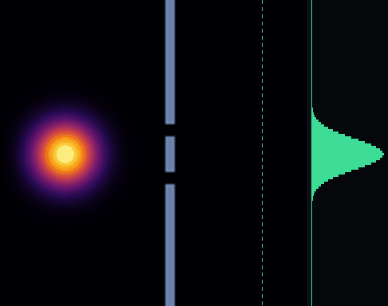](playground/index.html)

Fire a wavepacket at a wall with two openings and an interference pattern
builds up on the detector screen, one arrival at a time. This is not a
cartoon of the pattern: every frame is a step of the time-dependent
Schrödinger equation, advanced with the split-operator method. The potential
acts in position space, the kinetic term acts in momentum space, and a fast
Fourier transform moves between the two. You can draw your own walls, change
the slits, or switch to a tunnelling barrier and watch part of the packet
leak through a region it classically cannot enter.

[Open the demo](playground/index.html) ·
[Background: step potentials and tunnelling](physics/tunneling.md)

## Hofstadter's butterfly

[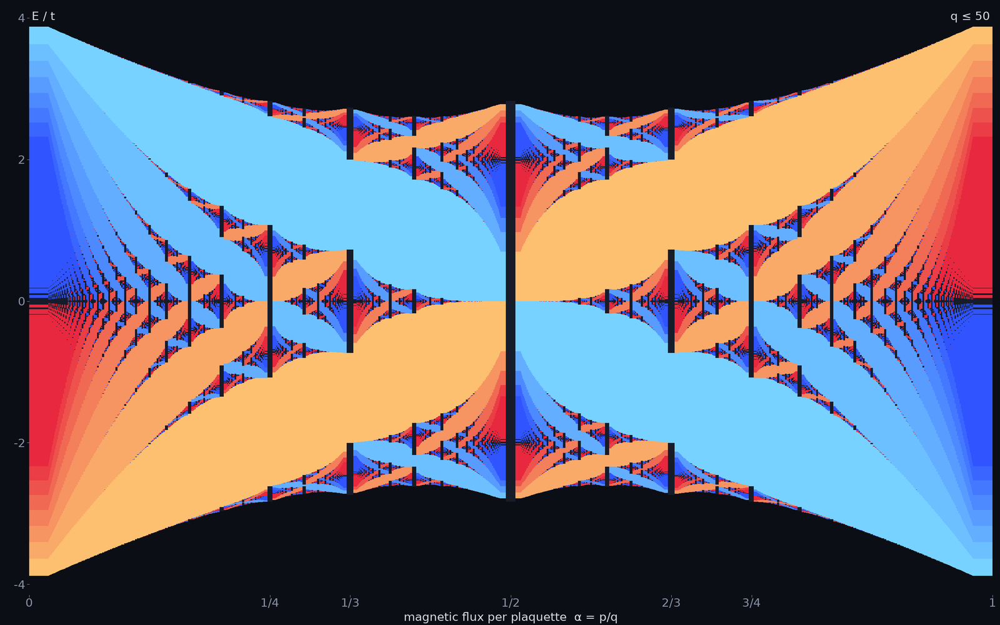](playground/butterfly.html)

Put an electron on a square lattice and thread a magnetic field through it.
When the flux per plaquette is a rational number p/q, the single band splits
into q sub-bands. Plot every allowed energy against the flux and a self-similar
fractal appears: Douglas Hofstadter's butterfly. Each gap in the spectrum
carries an integer, the Chern number, which counts the quantised Hall
conductance when the Fermi level sits in that gap. The explorer labels every
gap, so you can see the topology and not only the picture.

[Open the demo](playground/butterfly.html)
[Background: tight-binding models and topology](physics/tight_binding.md)

## Klein paradox and Zitterbewegung

[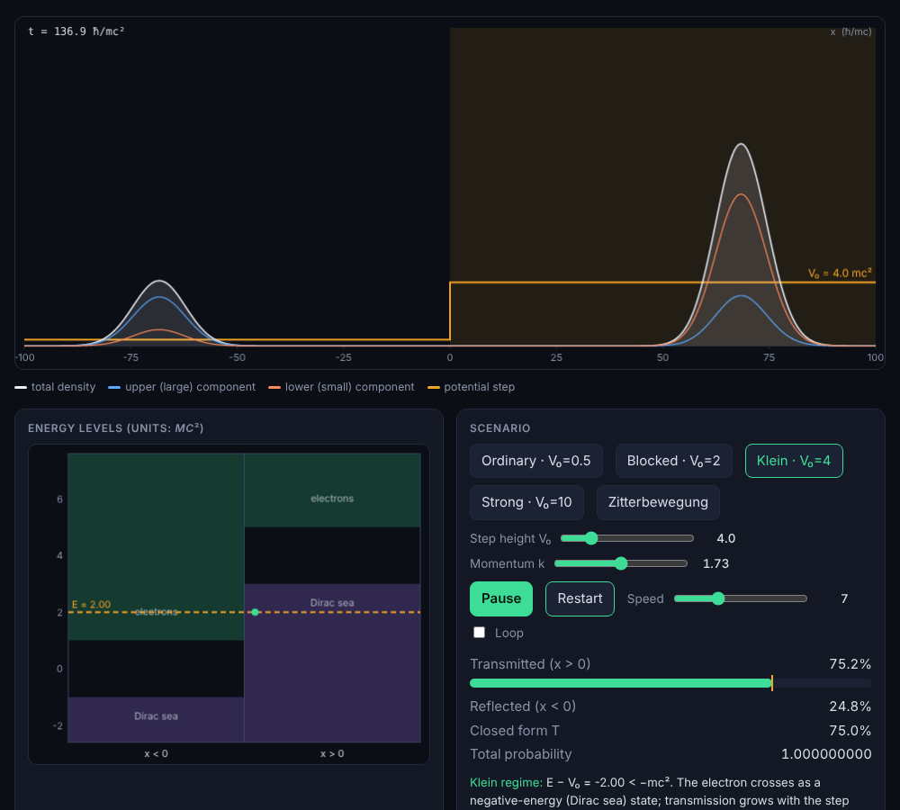](playground/dirac.html)

In non-relativistic quantum mechanics a particle meeting a barrier higher
than its energy is mostly reflected and its transmission decays. The Dirac
equation behaves differently: once the step exceeds the energy gap, the
particle can transmit through negative-energy states. This demo evolves a
relativistic wavepacket into a sharp step with an exact split-operator
propagator and compares the transmitted weight with the closed-form
plane-wave result. A second scene shows Zitterbewegung, the rapid trembling
of a free electron that comes from interference between its positive- and
negative-energy components.

[Open the demo](playground/dirac.html) ·
[Background: relativistic QM](physics/relativistic.md)

## Hydrogen orbitals as a rotatable point cloud

[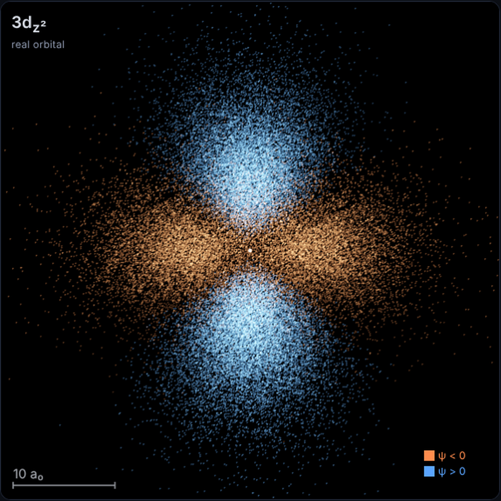](playground/orbitals.html)

Pick any n, l and m and the page draws that orbital as tens of thousands of
points, each one a position where the electron could be found. The radial
distance is sampled from the library's hydrogen radial wavefunction and the
direction from the spherical harmonic, in real or complex form, with colour
marking the sign of the wavefunction. Rotate it, and compare `s`, `p`, `d`
and `f` shapes directly.

[Open the demo](playground/orbitals.html) ·
[Background: the hydrogen atom](physics/hydrogen.md)

## A qubit on the Bloch sphere

[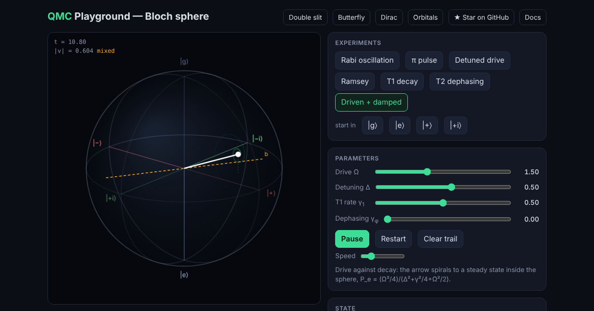](playground/bloch.html)

A two-level system is a point on a sphere. Drive it and the point rotates
(Rabi oscillations); let it decay and the point spirals inward. The demo
integrates the Lindblad master equation with amplitude damping and dephasing
and converts the 2×2 density matrix into a Bloch vector at each step.
Detuning, drive strength and both decay rates are adjustable, and the steady
state matches the analytic result for a driven, damped qubit.

[Open the demo](playground/bloch.html)

## Anderson localisation: why disorder stops a wave

[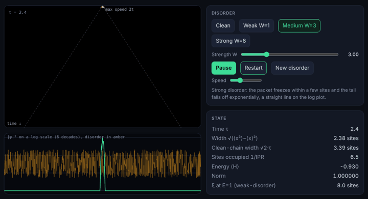](playground/anderson.html)

On a perfect chain a particle started on one site spreads at a fixed speed,
so the cloud grows in proportion to time. Give every site a random energy
and, in one dimension, it stops: the wavefunction freezes with an exponential
tail, however weak the disorder. This is Anderson localisation, the reason a
disordered wire is an insulator. The demo draws $|\Phi|^2$ against time as a
waterfall, so the light cone of the clean chain and the frozen column of the
disordered one sit side by side. The clean-chain width matches the exact result
$\sqrt{2} \cdot t \cdot \tau$, and the weak-disorder localisation length is
checked against a transfer-matrix calculation in the test suite.

[Open the demo](playground/anderson.html)
[Background: Anderson localisation](physics/anderson.md)

## The quantum walk

[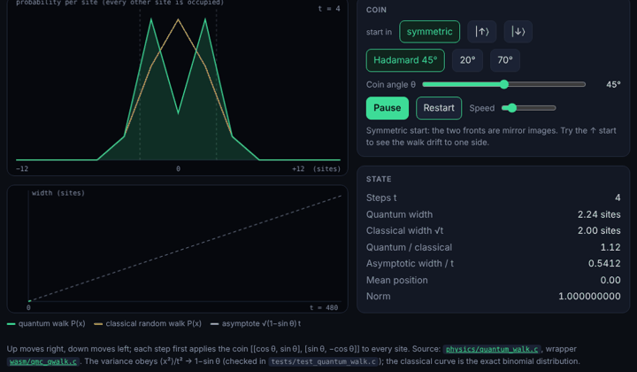](playground/quantum_walk.html)

Flip a coin, then step left or right. A classical walker ends up within about
$\sqrt{t}$ steps of the start after `t` steps. A quantum walker uses a quantum
coin and keeps both outcomes in superposition, so its amplitudes interfere:
the cloud spreads in proportion to `t`, and the probability piles up near the
edges of the light cone instead of the middle. The demo draws both walks
together and lets you change the coin angle, for which the spreading rate has
the exact form $\sqrt{1 - \sin(\theta)} \cdot t$. This is the same mechanism
behind quantum-walk search algorithms.

[Open the demo](playground/quantum_walk.html)
[Background: quantum walk](physics/quantum_walk.md)

## Landau-Zener: jumping across an avoided crossing

[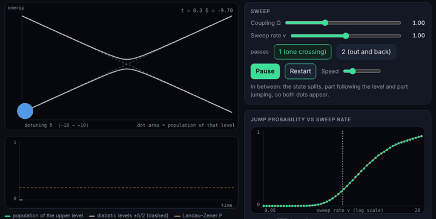](playground/landau_zener.html)

Two energy levels that would cross are pushed apart by a coupling into an
avoided crossing. Sweep the control parameter through it slowly and the
system follows its level; sweep it quickly and it jumps across the gap, with
the probability $\exp(-\pi\Omega^2/2v)$ found independently by Landau, Zener,
Stückelberg and Majorana in 1932. The demo integrates a qubit through the crossing
and overlays the closed form on a scan of the sweep rate, then sweeps out and
back so the two paths interfere: the fringes stay inside the envelope
4P(1-P). This is how qubits are initialised, read out and probed in many
superconducting and spin-qubit experiments.

[Open the demo](playground/landau_zener.html)
[Background: Landau-Zener sweeps](physics/landau_zener.md)

## The kicked rotor: where quantum mechanics tames chaos

[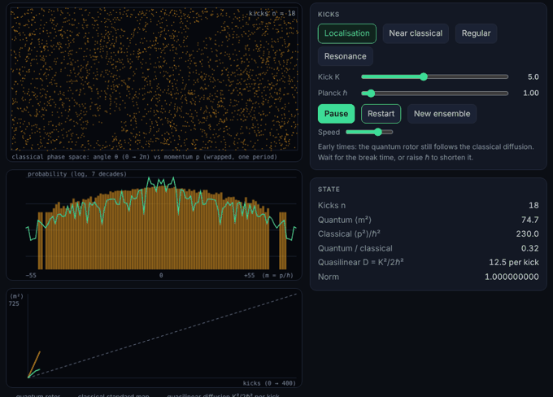](playground/kicked_rotor.html)

Kick a rotor with the same impulse once per turn. Classically this is the
Chirikov standard map: for strong kicks the motion is chaotic and the
momentum random-walks without limit, so its mean square grows in proportion
to the number of kicks. The quantum rotor, kicked in exactly the same way,
follows the classical diffusion for a few kicks and then stops. Quantum
interference freezes the spreading, leaving a momentum distribution with
exponential tails: dynamical localisation, the momentum-space cousin of
Anderson localisation, and one of the first signatures of quantum chaos. At
the special value $\hbar = 4\pi$ the free rotation drops out and the spreading
is ballistic with the exact result $\langle m^2 \rangle = (nK/\hbar)^2/2$,
which the test suite checks to 1e-13.

[Open the demo](playground/kicked_rotor.html)

## The SSH chain: a topological insulator you can build in one line

[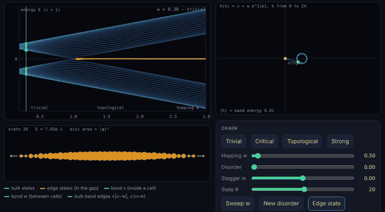](playground/ssh_chain.html)

A chain of atoms with alternating strong and weak bonds is the simplest
topological insulator. Start with the strong bond inside each cell and the
chain is an ordinary insulator. Strengthen the bond between cells instead
and the bulk gap closes and reopens, but the chain has changed: the phase
of the bulk Bloch function now winds once around the origin (winding number
1, Zak phase $\pi$), and two states appear in the gap, one at each end, with
energy exponentially close to zero. The page diagonalises the finite chain
live, so you can drag the hopping through the transition and watch the pair
peel off the band edge, then switch on random hopping and see that the edge
states do not move: chiral symmetry protects them. Break that symmetry with
a staggered potential and they shift to $\pm m$. The test suite checks the
edge energy, the decay length $1/\ln(w/v)$, the winding number and the Zak
phase against their closed forms.

[Open the demo](playground/ssh_chain.html)

## The Ising quench: a light cone and a return probability that vanishes

[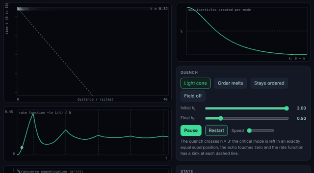](playground/ising_quench.html)

Take 256 spins in the ground state of a transverse-field Ising chain and
change the field suddenly. Correlations between distant spins do not
respond at once: they spread outwards at a finite speed, $4\cdot \min(J, h)$,
and the region the news has not reached stays exactly as it was. That is a
light cone, and it appears here as a picture of $\langle \sigma^z_0 \sigma^z_r
\rangle$ against distance and time. If the quench crosses the critical point,
the probability to find the chain back in its initial state passes through
zero at isolated times, and the rate function $-\ln(L(t)/N)$ has kinks there:
dynamical quantum phase transitions. The solution is exact, with no truncation,
because the chain maps to free fermions: each pair of momenta is a spin that
precesses about the new field, correlations are Pfaffians of the resulting
Fourier sums and the return probability is a product over modes. The test
suite checks the magnetisation, the echo and the correlations against exact
diagonalisation to 1e-13, and the critical times against their closed form.

[Open the demo](playground/ising_quench.html)

## The Haldane model: a Chern insulator with one-way edge states

[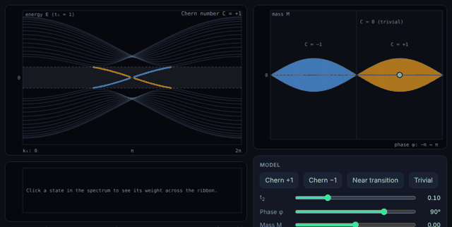](playground/haldane.html)

Graphene with a twist. Let electrons hop to their next-nearest neighbours
with a complex amplitude $t_2 \exp(\pm i \phi)$, a phase that mimics a
magnetic field that points up in one half of each cell and down in the other,
so that the net flux is zero but time-reversal symmetry is broken. Add a
sublattice mass M and the Dirac points open into a gap, with a Chern number
$\pm 1$ when $|M| < 3 \sqrt{3} \cdot t_2 |\sin(\phi)|$ and 0 otherwise. Cut a
ribbon out of the lattice and the invariant becomes visible: exactly one state
per edge crosses the gap, and the two move in opposite directions, so an
electron on one edge cannot scatter backwards because the only state to scatter
into is on the far side of the sample. The page draws the ribbon spectrum,
colours each state by the edge it lives on, shows its profile across the ribbon
and lets you click through the phase diagram. The test suite checks that the
number of edge crossings and their direction match the Chern number for both
signs of $\phi$, that the trivial phase has no states in the gap, and that
graphene's zigzag ribbon has its flat band of zero modes.

[Open the demo](playground/haldane.html)

## Kerr cat states: a quantum state you can see go negative

[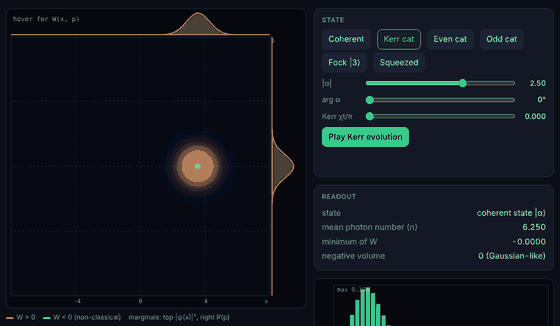](playground/wigner.html)

A classical state of light is a point in phase space; a quantum state is a
quasi-probability cloud, the Wigner function $W(x, p)$, whose marginals are
true position and momentum distributions but which is allowed to go
negative. Start with a coherent state, a Gaussian blob. A Kerr medium adds a
phase that grows as $n(n-1)$ with the photon number, so the blob smears
around its ring; at a quarter of the revival time, $\chi t = \pi/2$, it has split
into the Schrödinger cat
$(\exp(-i \pi /4)|i\alpha \rangle + \exp(i \pi / 4)|-i\alpha \rangle)/\sqrt{2}$:
two blobs and a fringe pattern between them that dips below zero. The page
lets you pick a coherent, Fock, cat or squeezed state, drag the Kerr time and
read off the negative volume, which is zero for a Gaussian and grows with how
non-classical the state is. The test suite checks the Wigner function against
the closed form for coherent and cat states, the marginals against $|\phi(x)|^2$,
$W(0,0) = (-1)^n/\pi$ for Fock states, the squeezed variances, and the Kerr cat
identity and the full revival at $\chi t = \pi$ to machine precision.

[Open the demo](playground/wigner.html)

## Grover search: amplitude amplification, and what happens when you overshoot

[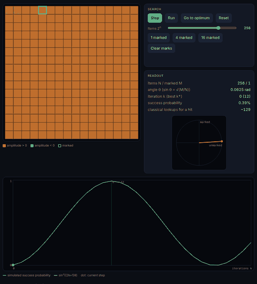](playground/grover.html)

Find the marked items in an unsorted database of N entries. Classically you
need about $N/M$ looks; Grover's algorithm needs about $(\pi/4) \sqrt{(N/M)}$.
The trick is geometric: the oracle flips the sign of the marked amplitudes, the
diffusion step inverts everything about the mean, and together they rotate the
state by $2\theta$ in the plane spanned by "marked" and "unmarked", with
$\sin(\theta) = \sqrt{(M/N)}$. After k iterations the success probability is
$\sin^2((2k+1)\theta)$, so it rises, peaks and falls again: keep iterating past
the optimum and you un-find the answer. The page shows all 1024 amplitudes as a
grid you can click to mark items, steps the algorithm, and plots the success
curve against the closed form. The test suite checks the full state-vector
simulation against the formula for several $(N, M)$, norm conservation, the
$M = N/4$ case that succeeds in one step, the $M = N/2$ case that cannot move at
all, and agreement with the library's single-target search.

[Open the demo](playground/grover.html)

## The Bell test: correlations no local theory can reproduce

[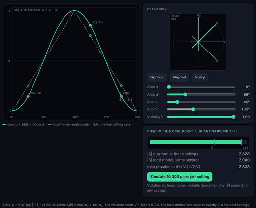](playground/bell.html)

Two detectors far apart each measure a spin along an angle they choose.
Suppose the outcomes are fixed in advance by some hidden variable the
particles carry; then the combination $S = E(a,b) - E(a,b') + E(a',b) +
E(a',b')$ of four correlations can never exceed 2 in magnitude. Quantum
mechanics disagrees: for the singlet the correlation is $-\cos(a-b)$, a
smooth cosine instead of the best local model's straight-line sawtooth, and
at the right four angles $S = 2\sqrt{2} \approx 2.83$ (Tsirelson's bound).
Mix in white noise of visibility V and S shrinks to $2\sqrt{2}\cdot V$, so
the violation survives only for $V > 1/\sqrt{2}$. The page lets you move
the 4 detector angles and the noise, compares the cosine with the local
sawtooth, and simulates pairs of measurements so you can watch the
statistical error bar shrink as $1/\sqrt{n}$. The test suite computes the
correlation from the density matrix rather than the closed form, finds the
Tsirelson maximum by grid search, checks that the deterministic strategies
and the hidden-angle model stop at exactly `2`, and tests the sampler against
the exact correlations.

[Open the demo](playground/bell.html)

## The quantum carpet: a wave packet that reassembles itself

[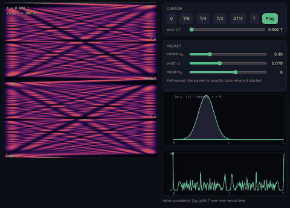](playground/carpet.html)

Drop a Gaussian packet into an infinite square well and let it bounce. It
spreads, collides with itself and the walls, and its probability density
paints an intricate woven pattern in space and time. The reason is that the
energies are $E_n = n^2$, so every mode's phase is a multiple of $2\pi$
after the same time T. At t = T the packet is exactly back; at T/2 it is
its own mirror image, and at T/4 it is a superposition of the packet and the
mirror image, a Schrödinger cat, with the same 1/2 return probability that
shows up as a peak in the autocorrelation. Every rational fraction of T
gives a finite number of copies. The page draws the carpet, lets you drag a
time cursor through it and shows the return probability. The test suite
checks the full, half and quarter revival identities exactly (to 1e-13), the
norm, the mean position and energy, and the return probabilities.

[Open the demo](playground/carpet.html)

## The quantum Zeno effect: a watched qubit never flips

[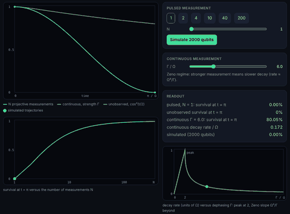](playground/zeno.html)

A resonant drive rotates a qubit from $|0\rangle$ to $|1\rangle$ in time
$\pi/\Omega$. Now interrupt it N times with a measurement of "is it still
in $|0\rangle$?". Each short interval leaves a flip probability of only
$(\Omega \tau/2)^2$ and every measurement resets the clock, so the chance
of surviving the whole run is $cos^{2N}(\Omega T/2N)$, which tends to 1 as
N grows: frequent observation freezes the evolution. The continuous version
replaces projective measurements by dephasing at rate $\Gamma$. The Bloch
equations then give a decay rate that rises as $\Gamma/2$, peaks at exactly
$\Omega$ when $\Gamma = 2\Omega$ and falls as $\Omega^2/\Gamma$ beyond it:
the harder you look, the slower it moves. The page shows survival through
time for any $N$ and $\Gamma$, Monte-Carlo trajectories that jump out one
by one, the survival at the end against N and the decay-rate curve. The test
suite checks the closed forms, the large-N exponential law, the Bloch equations
against $\cos^2(\Omega t/2)$ and the analytic rate for both regimes and the
trajectory statistics.

[Open the demo](playground/zeno.html)

## The quantum corral: standing waves in a circle

[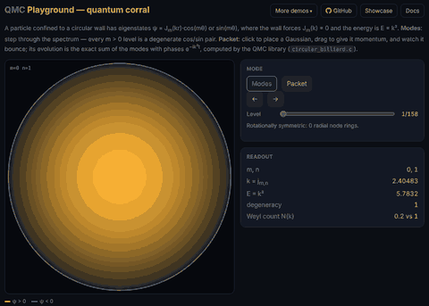](playground/corral.html)

Confine a particle to a disc and its allowed states are the standing waves
of a drum: $J_m(kr)\cos(m \theta)$ and $J_m(kr)\sin(m \theta)$, with $k$ the
zeros of the Bessel function Jm and energy $k^$. Each state has
$n−1$ circular nodes and $2m$ radial nodal lines; every level with $m \geq 1$
is doubly degenerate because the cosine and the sine can be rotated into each
other. The same picture is what scanning-tunnelling microscopists saw when
they built rings of iron atoms on copper. The page lets you step through the
modes and also fires a Gaussian packet into the disc, expanded in 156 modes,
to watch it ricochet off the wall and interfere with itself. The test suite
checks the Bessel function and its zeros against tabulated values, the
orthonormality of the modes on a polar grid, the node counts of every mode with
$k \leq 20$, the boundary condition, the eigen-equation by finite differences and
Weyl's law for the number of levels.

[Open the demo](playground/corral.html)

## The Hubbard dimer: where a band becomes a magnet

[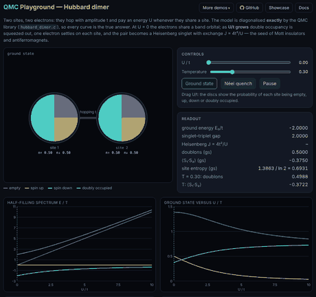](playground/hubbard.html)

Two sites, two electrons, hopping t and an on-site repulsion U: the smallest
model of strongly correlated matter, small enough to diagonalise exactly. At
$U = 0$ the electrons share a band orbital and half the weight sits on doubly
occupied sites. As U grows the ground-state energy $U/2 − \sqrt{(U^2/4 + 4t^2)}$
tends to $−4t^2/U$, double occupancy dies, one electron settles on each site and
the pair becomes a Heisenberg singlet with exchange
$J = 4t^2/U$ ($\langle S_1 \cdot S^2 \rangle$ goes from −3/8 to −3/4). The
entanglement entropy of one site climbs from charge fluctuations to the pure-spin
value $\ln(2)$. The page also quenches the Néel state $|uparrow,\downarrow\rangle$,
whose staggered moment oscillates at J and shows how thermal excitation across the
singlet–triplet gap melts the correlation. The tests check the spectrum and ground
state against their closed forms, the large-U Heisenberg limit, energy and norm
conservation in the quench and the infinite-temperature averages.

[Open the demo](playground/hubbard.html)

## Resonant tunnelling: a trap you can walk through

[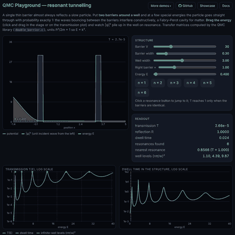](playground/tunnel.html)

One thin barrier reflects a slow particle almost completely. Put two of them
around a well and, at a few special energies, the particle gets through with
probability exactly 1: the waves bouncing between the barriers interfere
constructively, just as light does in a Fabry–Perot cavity. Those energies are
the quasi-bound levels of the well, a little below the infinite-well values
(nπ/w)², and the more opaque the barriers the narrower the peaks and the
longer the particle dwells inside. The page lets you set the heights and
thicknesses of the barriers, the well width and its floor, then drag the
energy to see the wavefunction pile up in the well at resonance. This is the
principle of the resonant-tunnelling diode. The tests compare the single
barrier with its closed forms (below, at and above the top), check
probability conservation by independent wave matching, reciprocity, the peak
height of 1 for symmetric barriers (and less for asymmetric ones), and that
the dwell time peaks on resonance.

[Open the demo](playground/tunnel.html)

## Run it yourself

Everything here builds from source with a single C compiler. See
[Building from Source](setup/building.md), or clone
[the repository on GitHub](https://github.com/Harshit-Dhanwalkar/QMC) and
read the `wasm/` directory to see how a physics routine becomes a browser
demo.
